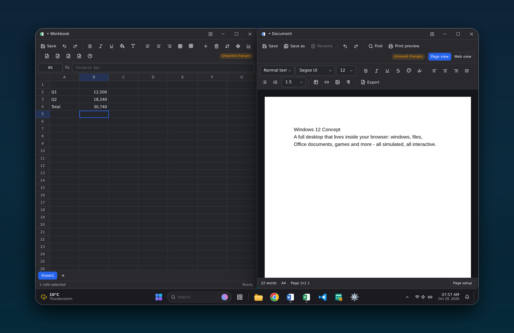
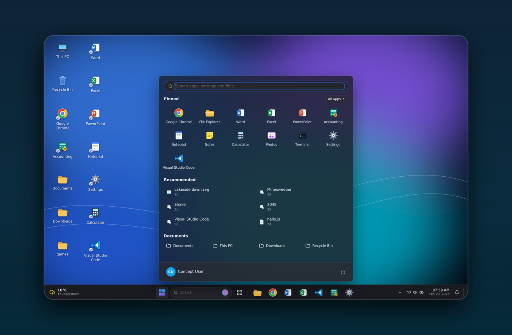
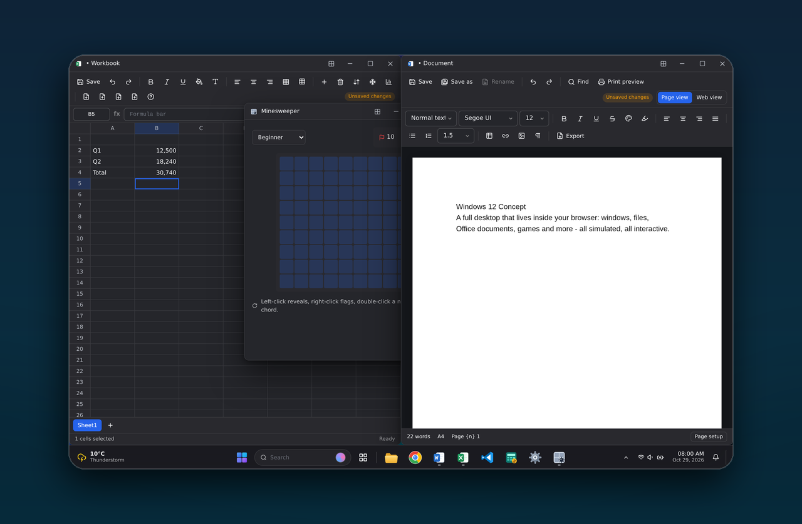

<div align="center">

# 🪟 Windows 12 Concept

### A full desktop operating-system concept that runs entirely in your browser

Boot it. Sign in. Drag windows. Write documents. Build spreadsheets. Play games.
Everything you see below is **real, working code** — not a video, not a mock-up.

[](https://github.com/hoseinsedaqat/Windows-12/actions/workflows/ci.yml)
[](https://hoseinsedaqat.github.io/Windows-12/)
[](https://react.dev)
[](https://www.typescriptlang.org)
[](https://vitejs.dev)
[](https://tailwindcss.com)
[](https://zustand-demo.pmnd.rs)
[](#-tests)

**[▶ Try the live demo](https://hoseinsedaqat.github.io/Windows-12/)** — password `1234`



*Real run of the simulator: Excel (left) with a live `=SUM()` formula and autosave badge,
Word (right) with a typed document — snapped side by side by dragging windows to the
screen edges, exactly like Windows 11.*

</div>

> **An unofficial, fan-made concept.** This project is **not** Windows, **not** a Microsoft
> product, and it is not affiliated with or endorsed by Microsoft. Every "system" surface
> (boot, lock screen, battery, Wi‑Fi, Bluetooth, Windows Update, security status, Task
> Manager metrics) is **simulated** and labelled as such in the UI. It never claims to
> control your real device.

---

## 🖼 Gallery

| Start menu & shell | Playable games |
| :---: | :---: |
|  |  |
| Centred Start menu with pinned apps, Recommended files and system folders — over the live desktop | Minesweeper in a real window: flags, chording, timer and persisted best times |

> 📸 **No hand-made mockups:** every screenshot in this README is captured by CI
> ([`.github/workflows/screenshots.yml`](.github/workflows/screenshots.yml)) driving the
> real UI with Playwright — boot, sign-in, search-launched apps, typed content, snapped
> windows — straight from a production build.

---

## ⚡ Quick start

```bash
npm install
npm run dev        # → http://localhost:5173
```

| Script | What it does |
| --- | --- |
| `npm run dev` | Vite dev server on `0.0.0.0:5173` |
| `npm run build` | `tsc -b` strict type-check + production bundle in `dist/` |
| `npm run typecheck` | Type-check only (strict mode) |
| `npm test` | 169 unit + integration tests (Vitest, jsdom, fake-indexeddb) |
| `npm run preview` | Serve the production bundle on `0.0.0.0:4173` |

First run: logo → loading → welcome → lock screen. Demo password **`1234`**
(change it in *Settings → Accounts → Sign-in options*, or enable auto sign-in).

---

## 🧭 What actually works

### Shell & system
- **Boot / lock / sign-in** — animated boot (skippable), lock screen with live clock and
  full date, password show/hide, wrong-password error, power + accessibility buttons.
  Restart / Shut down / Lock / Sign out all run the real state machine.
- **Desktop** — wallpaper switching (8 generated wallpapers + your own uploads), icon
  drag, marquee multi-select, click-to-select / click-again-to-open, custom context menus,
  icon sizes, sort, auto-arrange, new folder / shortcut, inline rename (F2), and
  **drag real files from your OS onto the desktop** to import them into the virtual file
  system (images and text inline, media up to 12 MB, honest notices for the rest).
- **Taskbar (Windows 11 style)** — centred Start + inline search box + Task View + pins
  with running indicators and jump lists, weather chip with a 5-day flyout (simulated and
  labelled), tray with hidden-icons flyout, network-volume-battery cluster, clock, bell,
  show-desktop sliver, auto-hide, position, alignment and icon-size options. Stays usable
  down to small viewports (scrolling centre cluster, compact clock).
- **Inline search** — the taskbar search box *is* the input: type and a compact flyout
  lists matching apps, files and Settings pages (↑↓ + Enter, Esc or click-away to
  dismiss), plus a "search the web" fallback. Small screens and `Ctrl+S` get the same
  experience as a compact flyout with its own input and recent files.
- **Window manager** — move, edge-resize (8 handles), minimize, maximize/restore, snap
  left/right/corners with snap-assist preview, z-order focus, Alt+Tab cycling, per-app
  multi-window or singleton behaviour, state preserved across reloads, title-bar context
  menu, double-click title to maximize, always clamped so a window can't be lost.
- **Snap layouts & snap groups** — the titlebar grid button opens a flyout with four
  fractional presets (halves, thirds, quarters, 2/3 + stacked 1/3). Picking a zone snaps
  the window and offers the remaining zones to other open windows, forming a *snap group*
  that restores together from Task View.
- **Virtual desktops** — Task View shows a desktop strip: add, rename-less switch, remove,
  and drag window cards between desktops. Each desktop has its own taskbar apps, Alt+Tab
  cycle and show-desktop state; `Ctrl+Shift+←/→` switch, `Ctrl+Shift+N` adds,
  `Ctrl+Shift+F4` closes the active desktop (the Win-key combos of real Windows are mapped
  to Ctrl here because the browser owns the Win key).
- **PWA + offline** — installable manifest, generated icons (incl. maskable) and a service
  worker that precaches the shell, serves navigations network-first with an offline
  fallback and hashed assets cache-first. After the first load the whole OS works offline.
- **Widgets board** — taskbar button opens live tiles: clock, simulated weather, top notes
  from the virtual file system, storage / open-windows / session-uptime stats and your
  next calendar events.
- **Screensaver & idle lock** — real inactivity tracking (pointer/keyboard) starts an
  animated floating-clock screensaver and can auto-lock the session; both configurable in
  Settings → Display, any input dismisses the screensaver.
- **Full backup / restore** — Settings → System → Backup exports *everything* (virtual
  file system, accounting, calendar, KV records, all persisted stores) into a single
  `.win12` file — a real ZIP archive written from scratch (stored entries, table CRC32)
  that any unzip tool can open. Importing validates and restores the session, then reloads.
- **Accessibility** — modals and compose dialogs trap focus (initial focus, Tab wrap,
  Esc, focus restore), the snap-layouts button is keyboard reachable, and shell inputs
  carry aria-labels; a dedicated hook (`useFocusTrap`) is unit-tested.
- **Responsive & input-safe** — windows re-clamp on resize/orientation change, panels size
  themselves with `min(…)` against the viewport, RTL mirrors everything, and the window
  layer is pointer-event audited with regression tests so chrome and app content always
  stay clickable.
- **Settings (39 pages)** — System (display, sound, notifications, focus, power, storage,
  multitasking, about), Bluetooth & devices, Network & internet, Personalization
  (background, colors, themes, lock screen, Start, taskbar, fonts), Apps, Accounts,
  Time & language, Privacy & security, Windows Update. Every control is wired to real
  state; simulated ones say so.
- **Quick settings / overlays** — brightness (0–100 live overlay), night light, volume +
  mute, Wi‑Fi / Bluetooth / airplane, focus, battery saver, cast & project (demo),
  accessibility (text size, high contrast, animations, pointer ring).
- **Notifications** — generated by real events, with history, per-item dismiss and clear
  all; suppressed by focus assist; can be turned off in Settings.
- **i18n** — English and Persian with full RTL, Persian calendar, Persian digits,
  locale-aware numbers/currency/dates, switchable live with no reload, plus **German** as
  a third locale (shell and core apps translated, everything else falls back to English).
- **Dynamic wallpaper & sound themes** — the "Dynamic" wallpaper picks sunrise / flow /
  forest / midnight by time of day and re-evaluates live; system sounds can be reshaped
  by four synthesis themes (classic / soft / retro / minimal). And yes, the About page
  hides an easter egg. 🥚
- **Real in-simulator web search** — the Concept Browser renders genuine results fetched
  live from the Wikipedia APIs (CORS), with type-ahead suggestions, a summary card and
  honest one-click buttons that run the same query on Google/Bing/DuckDuckGo/YouTube in a
  real browser tab.

### Applications (26)
| App | Highlights |
| --- | --- |
| **File Explorer / This PC** | Home, Desktop, Documents, Downloads, Pictures, Music, Videos, OneDrive (demo), This PC, Recycle Bin. Grid/list/details, sortable columns, breadcrumbs, search, type filter, back/forward history, multi-select, copy/cut/paste, rename, delete/restore, new folder, drag & drop, properties, folder sizes, storage usage, **real uploads** through the file picker, downloads of virtual files. "New" creates Folder / Word / Excel / PowerPoint / Text / Note / Shortcut and opens it in the matching app. |
| **Word** | Rich-text editor with autosave, Save / Save As, rename, undo/redo, bold/italic/underline/strike, font family + size, colour + highlight, headings, lists, alignment, line spacing, tables, links, images, page setup (A4/Letter + margins), find, word count, page view + print preview, TXT/HTML export, **real `.docx` export**, PDF through the browser print dialog, full RTL/Persian. |
| **Excel** | Grid with row numbers and column letters, formula bar, name box, sheet tabs, status bar. Arrow/Tab navigation, ranges, copy/paste, column width & row height, insert/delete rows & columns, freeze panes, sort, filter, cell formats (number/text/percent/date/currency), bold, fill, alignment, borders, charts. **Formula engine is a real tokenizer + AST evaluator — no `eval`, no string substitution** — supporting `SUM, AVERAGE, MEDIAN, MIN, MAX, PRODUCT, COUNT, COUNTA, IF, IFERROR, AND, OR, NOT, ABS, ROUND, INT, MOD, POWER, SQRT, LEN, UPPER, LOWER, TRIM, CONCAT(ENATE), TEXTJOIN, TODAY, NOW, VLOOKUP, XLOOKUP, SPARKLINE, SUMIF, COUNTIF` with `#REF! #DIV/0! #VALUE! #NAME? #NUM? #CYCLE!` errors, **conditional formatting** (data bars, color scale, greater/less rules, duplicates, contains-text) applied over the virtualized grid, CSV import/export and **real `.xlsx` export + import**. |
| **PowerPoint** | Slide list, add/delete/duplicate, drag-reorder, 5 layouts, templates, title/text elements, images, shapes, background colour, font + size, move/resize with handles and live preview, speaker notes, slideshow with keyboard navigation, autosave, PNG export, PDF via print, **real `.pptx` export**. |
| **Notepad / Notes** | Plain text with autosave option, find & replace, line/character counts, save status; Notes with titles, tags, colours, pinning, search, trash & restore — both stored in the same virtual file system. |
| **Browser (Concept Browser)** | Tabs (new/close/reorder/drag), back/forward/reload, address bar + search, bookmarks, history, downloads, three-dot menu, settings, `win://` internal pages, modern new-tab page. Sites that allow framing are shown in a sandboxed iframe; the rest get an **honest notice** plus "open in a real browser tab". It never fakes a certificate or security state. |
| **Accounting** | Dashboard (cash, receivables, payables, income, expense, net profit, margin, overdue alerts), Customers, Suppliers, Accounts, Invoices (lines, per-line discount %, extra discount, tax, issue/due dates, draft → unpaid → partial → paid, payments), Income, Expenses, Transactions, Profit & loss, Cash flow, Categories, Settings (company, currency, tax rate, invoice prefix, next number, fiscal year start). Search, filters, pagination, CSV export, printable invoices, IndexedDB persistence, clearly labelled demo data, real arithmetic with cent rounding. No bank, tax or external service is contacted. |
| **Visual Studio Code (concept)** | CodeMirror-powered editor over the virtual file system: explorer sidebar tree, tabs with dirty dots, syntax highlighting for JS/TS/JSON/HTML/CSS/Markdown/Python, dark/light editor themes, menu bar, command palette (Ctrl+Shift+P), Ctrl+S saves into IndexedDB, status bar with Ln/Col and language mode. Sample source files ship in Documents. |
| **Games — Minesweeper, Snake, 2048, Tetris, Solitaire** | Playable classics: Minesweeper with three difficulties, first-click safety, flags, chording, timer and best-time records; Snake with keyboard/touch controls, growing speed and high scores; 2048 with merges, score/best tracking and win detection; **Tetris** with a seeded pure engine (wall-kick rotation, ghost piece, hard drop, line-clear scoring, levels) and a persisted best score; **Klondike Solitaire** with drag & drop, double-click to foundation, stock recycling, greedy auto-complete and a fewest-moves record. |
| **Media Player** | Plays the audio/video files *you* import (Explorer upload or desktop drop inlines media up to 12 MB as data URLs): playlist sidebar, play/pause, seek bar, next/prev with wrap-around, a WebAudio spectrum visualizer for audio, and an honest notice for files too large to store. The seed ships a tiny generated WAV so it works out of the box. |
| **Mail (simulated)** | Folder sidebar with unread badge, message list and reading pane, star / read / trash / restore / delete-forever, compose with validation and a local reply bot that answers sent mail after a few seconds — labelled everywhere as simulated: nothing ever leaves the browser. |
| **Calculator, Calendar, Clock, Run, Photos, Paint, Terminal, Task Manager, Recycle Bin, Settings** | Scientific calculator with history/memory (own shunting-yard evaluator); calendar with events; world clock + timer + stopwatch + alarms; Run dialog with real shell commands; Photos with viewer/slideshow, "set as wallpaper" and a **real editor** — rotate, flip, five filters and drag-to-crop with live preview, saved as a new PNG file in the VFS; paint with brush/eraser/shapes/fill/eyedropper/undo; a 38-command simulated shell over the virtual file system; task manager with processes and end-task. |

### Keyboard shortcuts
`Win/Ctrl+Esc` Start · `Win+E` Explorer · `Win+I` Settings · `Win+R` Run · `Win+L` Lock ·
`Win+D` Show desktop · `Win+S` Search · `Alt+Tab` switch apps · `Ctrl+Shift+Esc` Task
Manager · `Esc` close overlays · `F2` rename · `Delete` move to Recycle Bin ·
`Ctrl+Shift+←/→` switch virtual desktop · `Ctrl+Shift+N` new desktop ·
`Ctrl+Shift+F4` close current desktop.
Shortcuts are only captured while the simulator is active and no text field has focus;
browser-reserved combinations are left alone.

---

## 🏗 Architecture

```
src/
├── core/            framework-agnostic logic (no React)
│   ├── FileSystem.ts        pure node-map file system (ids are stable, paths are views)
│   ├── ApplicationRegistry  app metadata: sizes, singleton, categories, handled kinds
│   ├── CommandManager       Run dialog / shell command parser
│   ├── Documents.ts         document model factories + type guards
│   ├── games/               pure Minesweeper / Snake / 2048 engines
│   └── spreadsheet/         cell refs, formula engine (tokenizer + AST), cell formatting
├── stores/          Zustand state: settings, system, window, fileSystem, shell,
│                    notification, quickSettings, calendar, browser, accounting
├── services/        IndexedDB (Dexie), formatting/i18n helpers, sounds, sanitising,
│                    auth (demo digest), launcher, weather, web search, office export
├── hooks/           useDocument (autosave/conflicts), useShortcuts, useSearch, useUi…
├── components/      shell: desktop, taskbar, start, panels, window chrome, dialogs, UI kit
├── applications/    23 lazily loaded apps, mapped by app id in registry.ts
├── data/            wallpapers, settings navigation model, seed content, sample images
├── i18n/            en.ts / fa.ts dictionaries (1275+ keys each) + hooks
└── tests/           Vitest suites (file system, formulas, windows, storage, settings,
                     accounting, documents, shell integration, power/session, games,
                     web search, weather, desktop interaction, window chrome, search)
scripts/
├── screenshot.mjs   Playwright driver that captures the README screenshots from a
│                    production build (boot → sign-in → launch → type → snap → shoot)
└── compose_shots.py Pillow composer: rounded corners, soft shadow, gradient backdrop
```

Design rules the code follows:

- **One source of truth.** Files live in `fileSystemStore` (persisted to IndexedDB) and
  every app reads/writes through it — Explorer, Search, Start, Terminal, Photos, Notes,
  Word/Excel/PowerPoint/Notepad all see the same nodes.
- **Pure core.** The file system, the formula engine and the game engines are plain
  functions over data, so they are unit-testable without a DOM or a database.
- **Stable identities.** A node's id never changes; paths, breadcrumbs and the Recycle Bin
  are derived views. Windows keep their id across minimize/maximize/reload.
- **Lazy loading.** Every app is a separate `React.lazy` chunk, so the shell boots fast and
  heavy apps (Excel, Accounting, Office export) load on demand.
- **Error boundaries.** A crashing app shows a recovery card instead of a white screen.
- **No click-swallowing overlays.** Window layers and panels are pointer-event audited and
  covered by regression tests, so chrome and app content always stay interactive.
- **Self-healing storage.** Corrupted or duplicated legacy seed data is repaired on hydrate
  (identity merge + dedupe), and storage failures degrade to in-memory with a visible
  warning instead of throwing.

### Persistence

| Data | Where |
| --- | --- |
| Settings, system/account, window layout, notifications, quick settings, browser state | `localStorage` (`win12-concept.*`) |
| Files, accounting ledger, calendar events, key/value side-app state | IndexedDB `windows12-concept` (Dexie) |

### Security & honesty

- All rendered rich text passes through DOMPurify; browser iframes are sandboxed.
- The demo password is stored as a salted digest and labelled as a demo credential — it is
  **not** real security, and nothing is ever uploaded.
- No `eval` / `new Function` anywhere: the calculator and the spreadsheet engine both parse
  user input into an AST first.
- Simulated surfaces (network, Bluetooth, battery, update, security, Task Manager metrics)
  carry an explicit "simulated" label in the UI.

---

##  Known limitations (stated, not hidden)

- A web page cannot change your real display resolution, system volume, printer, proxy,
  Bluetooth hardware, or OS settings. Those pages explain this and control the simulator
  only.
- Many websites refuse to be embedded (`X-Frame-Options` / CSP). The browser says so and
  offers to open the page in a real tab; it never pretends a blocked page loaded.
- `.docx` / `.xlsx` / `.pptx` export produce genuine OOXML packages, but only for the
  feature subset this simulator models (e.g. Word tables and lists, Excel values/formats,
  PowerPoint shapes and text). PDF output goes through the browser's print dialog.
- Accounting is a teaching/demo ledger: no bank feeds, no tax filing, no audit trail
  guarantees. Do not use it for real bookkeeping.
- The shell is desktop-first: it adapts down to small viewports (scrolling taskbar,
  viewport-clamped panels and windows), but a touch-phone layout is not the target.

---

## 🧪 Tests

```bash
npm test
```

217 tests across 29 suites — every headline feature has at least one suite:

- `fileSystem.test.ts` — create/rename/move/copy/duplicate, soft delete → Recycle Bin →
  restore → purge, clipboard semantics, paths, search, sorting, sizes, seed integrity.
- `spreadsheet.test.ts` — cell references, formula parsing, dependency collection,
  aggregates, `IF/AND/OR/NOT`, text & lookup functions, error codes, cycle detection,
  number/currency/percent/date formatting, Persian digits, user input parsing.
- `windowManager.test.ts` — unique ids, singleton vs multi-instance, clamping, minimize /
  maximize / restore previous size, z-order, snapping, desktop resize, show desktop,
  Alt+Tab, close/end-task, pinning.
- `windowChrome.test.tsx` — titlebar close/minimize actually close/minimize, frames keep
  `pointer-events: auto`, no full-screen overlay wraps windows, drag starts only after
  real movement (so button clicks survive).
- `openFiles.test.tsx` — opens every seeded file (docs, sheets, slides, text,
  notes, images, shortcuts) in its app and asserts no error boundary appears.
- `search.test.tsx` — inline taskbar search: empty query shows nothing, compact flyout on
  typing, web fallback row, Enter opens the active hit, Esc / click-away dismiss, compact
  recents mode for small screens.
- `settings.test.ts` — section merges, airplane-mode radio logic, language/calendar/number
  system coupling, appearance, default & startup apps, quota, deep patch, localStorage
  persistence + rehydration, reset, locale-aware formatting.
- `storage.test.ts` — IndexedDB init, KV rows, `safeWrite` success/failure, seeding,
  reload recovery, content updates, rename collisions, trash lifecycle, system-folder
  protection, clipboard, quota, recent files, backup import/reset, hydrate self-healing.
- `accounting.test.ts` — invoice maths (line discounts, extra discount, tax, clamped
  payments, cent rounding), statuses, overdue rules, periods, report summary, and the full
  store flow: customer → invoice → issue → payment → balances → reports → reload.
- `documents.test.ts` — document factories for every kind, Word save/reload/DOCX export,
  HTML sanitising, Excel formulas surviving a reload + real XLSX round-trip, PowerPoint
  slides/notes/shapes + PPTX export, Notepad/Notes persistence.
- `games.test.ts` — Minesweeper (first-click safety, flood reveal, flags, chording,
  win/lose), Snake (movement, reversing, eating, wall & self collision, pause),
  2048 (merges, scoring, dead-board detection, random tiles).
- `websearch.test.ts` — Wikipedia API URL shape (`origin=*`), result parsing, HTML
  stripping, language subdomains, network-failure path, suggestions, external engines.
- `weather.test.ts` — deterministic per-day simulation, forecast range sanity, °F conversion.
- `desktop.test.tsx` — icon rendering, single click selects, second click opens, and no
  accidental open when clicks are far apart in time.
- `power.test.ts` — demo credential hashing (per-password salt, legacy fallback), boot →
  lock → sign-in, wrong password, auto sign-in, lock/unlock/sign-out, restart & shutdown
  with files, settings and windows intact, activity history, account persistence,
  simulated update check.
- `shell.test.tsx` — renders the real app: boot → lock → desktop, opens every heavy app,
  drives all shell panels, applies brightness/theme/language live, opens context menus and
  dialogs, and verifies quick settings stay consistent with the settings store.

---

## 🗺 Roadmap ideas

Shipped in the latest round: virtual desktops, PWA/offline, host-file drag-in, snap
layouts + groups, Media Player, Photos editing, `XLOOKUP` / `SPARKLINE` / conditional
formatting, Tetris + Solitaire, simulated Mail, visual-regression and E2E-smoke CI,
focus traps, German locale, `.win12` backup/restore, screensaver/idle lock, widgets
board, dynamic wallpaper and sound themes.

Still open:

- Date maths and more spreadsheet functions.
- Slide transitions and richer shape editing.
- Multi-user accounts with per-user file trees.
- Full German translation (currently shell + core apps, rest falls back to English).

---

<div align="center">

**Built as a design/engineering concept — enjoy exploring it.**
And remember: it's a simulator, not an operating system. 🪽

</div>
